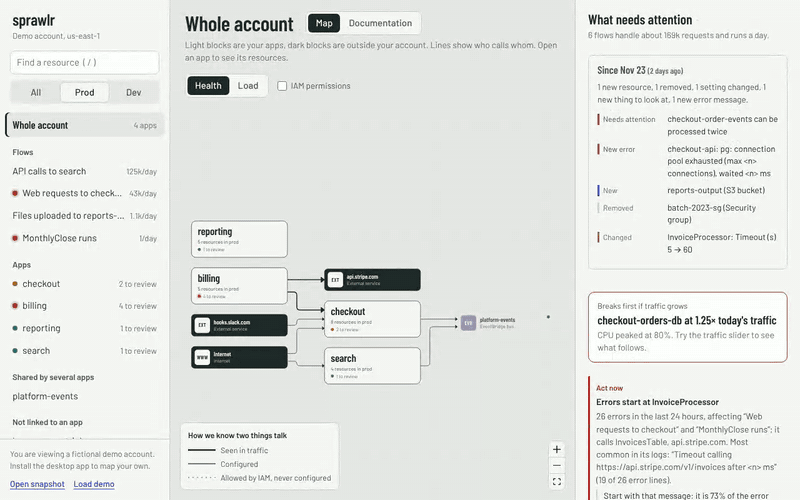
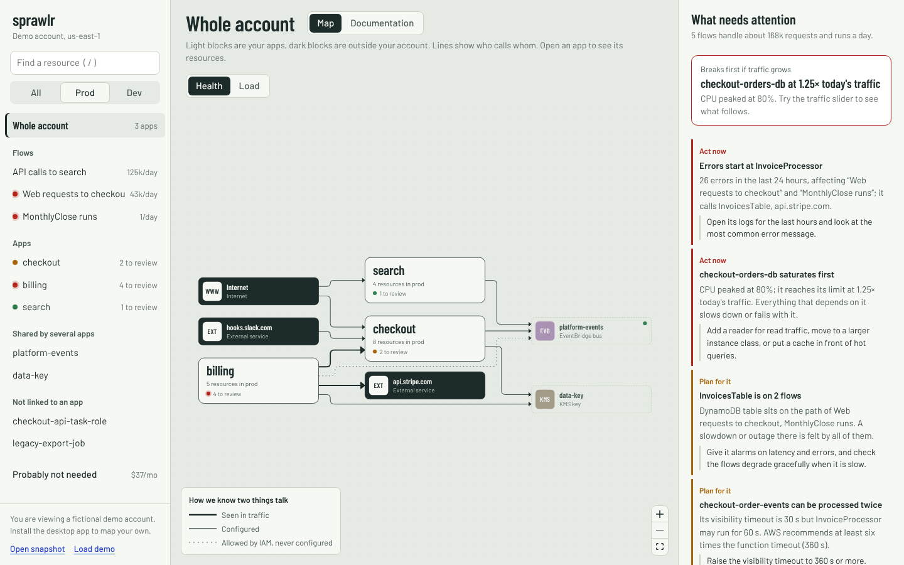
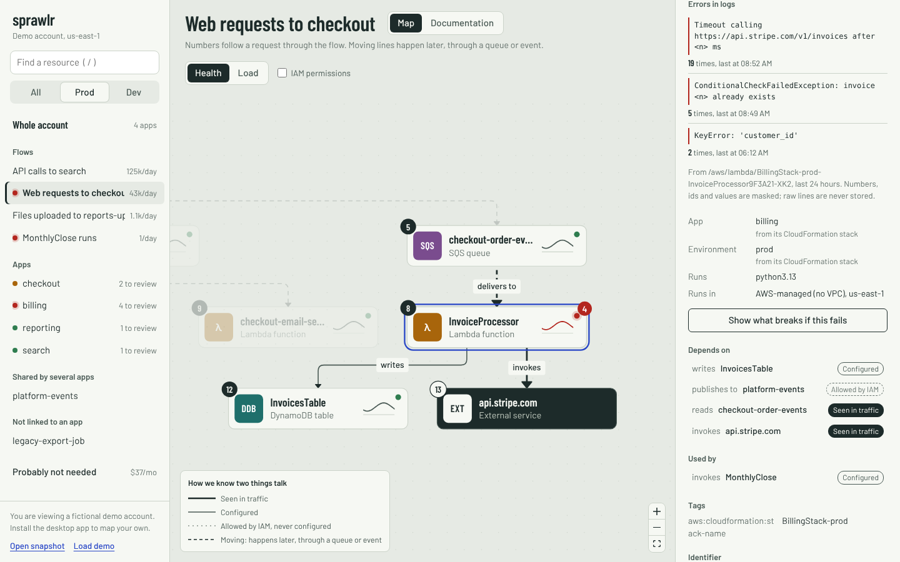
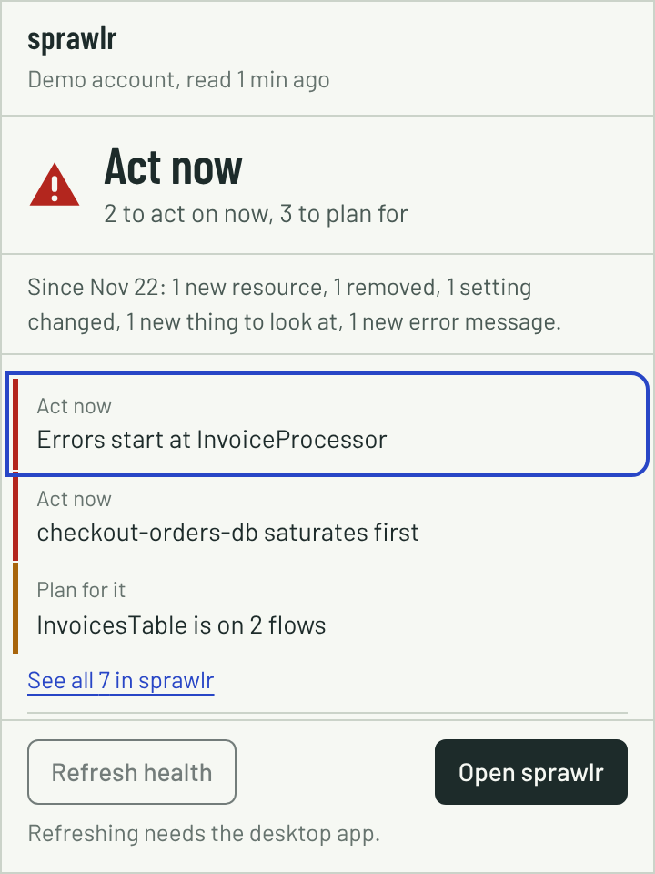
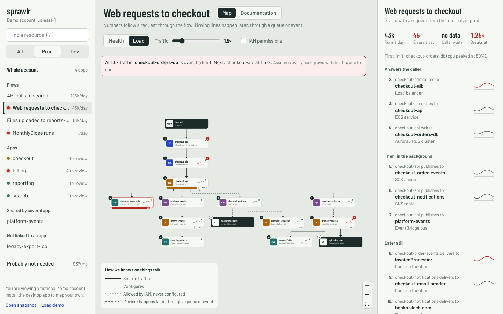
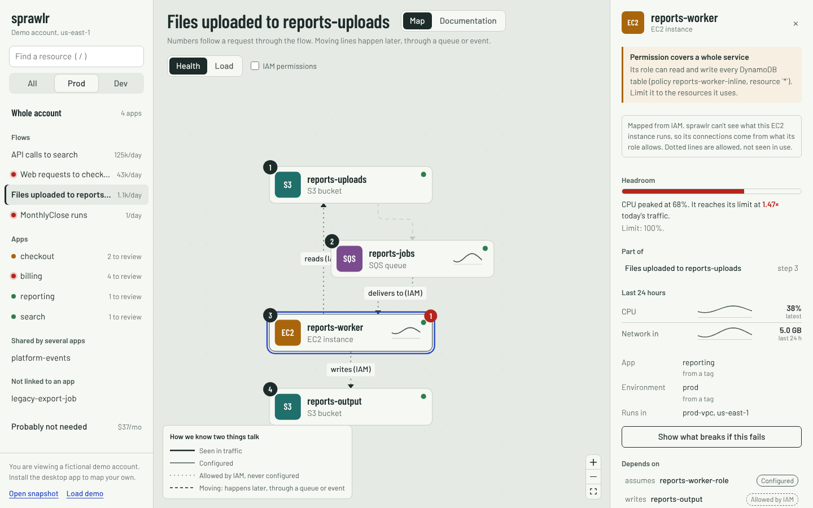

# sprawlr

[](https://github.com/gonzaloan/sprawlr/actions/workflows/ci.yml)
[](https://github.com/gonzaloan/sprawlr/releases)
[](LICENSE)

A local desktop map of your AWS account. It reads your infrastructure (read-only), works out which resources belong to which app and environment, and draws how they talk to each other.

**[Try the demo in your browser](https://gonzaloan.github.io/sprawlr/)**: a fictional account, nothing to install. The [tray popover](https://gonzaloan.github.io/sprawlr/?view=tray) is there too. Scanning your own account needs the desktop app.



## Why not the AWS console or the AWS CLI

The AWS Management Console shows one service at a time, and the AWS CLI returns lists. Neither tells you that a CloudFront distribution, a load balancer, an ECS service, an Aurora database and the queues and functions behind them are one checkout flow, that the database saturates at 1.25× today's traffic, or that the flow's errors start with a Stripe timeout. sprawlr joins what those reads return into apps and flows, says what each connection rests on (traffic, configuration or only IAM), and keeps it on your machine.

## What it shows

- **What needs attention**, first thing on screen: where errors start, what saturates first if traffic grows, queues that can lose or duplicate messages, dependencies many flows share. Each item says why and what to do.

  
- **Flows**: the paths requests and events take, found from entry points (public endpoints, schedules) and told step by step: what answers the caller, then what happens later through queues and events. Each flow shows its runs, errors, wait time and where it breaks first.
- **Why it fails**: with error logs on, sprawlr asks CloudWatch Logs Insights for the last 24 hours of error lines of every function and container it found, and reduces them to patterns (`Timeout calling https://api.stripe.com/v1/invoices after <n> ms`, 19 times). Numbers, ids, emails, addresses, tokens and quoted values are masked, and raw lines are never stored. Each flow lists its most frequent errors, and "Errors start at X" names the message to fix first. Off by default: Logs Insights reads log content and bills per GB scanned.

  

- **What changed since the last scan**: every scan is compared with the previous one of the same account. It lists resources added and removed, settings that moved (memory, timeouts, images, capacity, encryption, exposure), connections gained and lost, what newly needs attention, health changes and new error messages. The briefing, the tray, the generated docs, the MCP server (`what_changed`) and `sprawlr changes --before a.json --after b.json` all say it the same way. The desktop app keeps the last 30 scans.

- **Navigation**: Back and Forward (⌘[ and ⌘] in the Mac app; the browser's own in the web demo, where every place also has a URL) and a trail from the whole account to the resource open. The environment switch appears only when some app runs in more than one environment.

- **Status from the menu bar**: sprawlr stays in the macOS menu bar or the Windows and Linux system tray. Its icon shows the account's level by shape (act now, plan for it, all clear, no status). A click opens a small card with the top items, the flows with errors and what is probably not needed, each one a click away in the full app. Background health refresh (every 15 min, 1 h or 4 h: up to 96 CloudWatch reads a day, each billed), notifications and launch at login are there too, all off by default.

  

- **Bottlenecks and what-if**: every resource's busiest hour against its limit (database CPU, service CPU and memory, Lambda concurrency, API throttles). Switch the map to Capacity and drag the slider to see what saturates at 1.5× or 3× and in which order. Maps without load figures don't offer it.

  
- **Resources you can't see inside**: an EC2 worker's code is out of sight, but its IAM role says what it can touch. sprawlr reads every role's policies (wildcards, `NotAction`, denies), turns specific grants into dotted "allowed by IAM" connections and follows them in flows when nothing else is known. An S3 upload that notifies a queue read by an EC2 worker becomes the flow "Files uploaded to reports-uploads". Grants on a whole service (`dynamodb:*` on `*`) are reported, never drawn as lines to everything.

  

- **Everything about a resource in one panel**: open anything from the map or search to see what it does, what needs attention, which flows it is part of, what it talks to, and how it is set up, in words. An IAM role says who can take it on (Lambda functions, another account, GitHub Actions…), what in the scan does, and what it may do by service, with the resources it reaches. A function or service names the role it runs as and what that allows; a table, bucket or queue lists the roles IAM lets in.

- **Architecture**: any place drawn the way an AWS architecture diagram does. What comes from the internet and through which edge services, then each region with its VPCs (a column per availability zone, a row per subnet tier) and what runs outside any VPC, grouped by what it does. It shows which availability zones each resource has subnets in, each resource's health, and the connections of the one you point at. Subnet tiers come from subnet names and public IP settings, and the view says which. sprawlr uses its own marks: the AWS Architecture Icons' terms cover diagrams and documents and don't say whether the icons can ship inside software.

- **Export as code**: the whole account or one app as a Terraform project (awscc provider) and CloudFormation templates, written from each resource's live configuration, with the documentation. References between resources become references in the code, and every resource has an import, so `terraform plan` checks the code against the account before you trust it: it should import everything and change nothing. Values that could be secrets (environment variables, passwords, tokens, user data) are never written; they become inputs you fill in. Resources a CloudFormation stack already manages are left out with that stack's name. See [examples/demo-export](examples/demo-export/README.md).

- **Probably not needed**: idle, orphaned and forgotten resources (NAT gateways with no traffic, unattached Elastic IPs, unused security groups, functions with no activity in 14 days, IAM roles unused for months) with the evidence and what they cost a month.

- **Apps**, grouped from tags, CloudFormation stacks, naming and connections. Every assignment says how it was inferred.
- **How components communicate**, with the evidence behind each line: seen in traffic (X-Ray), configured, or only allowed by IAM. Third parties your code calls (payment APIs, webhooks, custom origins) appear as dark blocks.
- **Health**: CloudWatch alarms on every node and 24 hours of the metrics that matter per service (requests, errors, latency, backlog, throttles), as sparklines on the map and in the details.
- **Where things run**: VPCs drawn as territories, environments (prod, dev…) as a filter.
- **What to review**: plain-text secrets, alarms and error spikes, public databases and buckets, unencrypted storage, internet exposure, unused or cross-environment permissions, secrets never rotated or unused.
- **Differences between environments**: what exists in prod but not in dev, and settings that drift (Multi-AZ, task counts, container image versions).
- **Blast radius**: select a resource to see everything that breaks if it fails.
- **Documentation**: one Markdown page per app (diagrams per environment, components, data flows, network, secrets, differences between environments, findings) plus an account index. Mermaid diagrams render on GitHub, GitLab and most wikis. See [examples/demo-architecture](examples/demo-architecture/README.md).

Secret values and data are never read. `iam-policy.json` grants only discovery calls and explicitly denies reading secrets, objects, items and messages. Telemetry uses `GetMetricData`, which CloudWatch bills (a few cents per scan); turn it off with `--no-telemetry` or the checkbox in the app. Error logs are the one exception to "never reads data": they are off unless you pass `--logs` or tick the box, and they need the separate `OptionalErrorLogs` statement in the policy (delete it to forbid them). sprawlr masks the lines into patterns in memory and stores only the patterns. Export as code reads each resource's configuration again, when you ask for it, through Cloud Control (cloud Control adds no charge; Secrets Manager and KMS bill their own reads by the request, a fraction of a cent for an account); it needs the `OptionalExport` statement, keeps the configuration in memory and writes it only to the folder you pick ([ADR 0006](docs/adr/0006-exports-read-configuration-on-demand.md)).

## What it reads

| Source | Gives |
|---|---|
| EC2 | VPCs, subnets, security groups and who can reach whom |
| IAM | roles, their trust policies, inline and customer-managed policies, instance profiles, permissions boundaries, last use (`GetAccountAuthorizationDetails`, one paginated call). Trust policy conditions keep their keys, never their values |
| Lambda | functions, triggers, roles, references in environment variables |
| Cloud Control | EC2 instances, ECS services and task definitions, load balancers and target groups, RDS/Aurora, API Gateway (HTTP), SQS (with dead-letter queues), SNS, DynamoDB, S3 (with event notifications), KMS, Step Functions (definitions are walked), EventBridge rules, CloudFront origins |
| Native APIs | REST API integrations, SNS subscriptions, secret rotation and last use, KMS key aliases (to name keys and tell AWS managed ones apart), tags |
| Telemetry | CloudWatch alarms, 24 hours of metrics, 14 days of activity counts, X-Ray service graph |
| Logs (opt-in, `--logs`) | error lines of Lambda and ECS (`awslogs`) log groups, counted by Logs Insights and kept only as masked patterns |

Each Cloud Control type is interpreted by a small pure function in `crates/sprawlr-aws/src/extract.rs`. Supporting a new service is one function and a JSON fixture test.

## Install

Download the installer for your system from [Releases](https://github.com/gonzaloan/sprawlr/releases):

| System | File |
|---|---|
| macOS with Apple silicon (M1 and later) | `sprawlr_<version>_aarch64.dmg` |
| macOS with an Intel processor | `sprawlr_<version>_x64.dmg` |
| Windows | `sprawlr_<version>_x64-setup.exe`, or `sprawlr_<version>_x64_en-US.msi` for managed installs |
| Linux | `sprawlr_<version>_amd64.AppImage` on any distribution, `sprawlr_<version>_amd64.deb` on Debian and Ubuntu, `sprawlr-<version>-1.x86_64.rpm` on Fedora and openSUSE |

To see which Mac you have, open the Apple menu → About This Mac: it shows "Chip Apple M…" or "Processor … Intel".

`SHA256SUMS` in each release lists the files' checksums. [SECURITY.md](SECURITY.md#installers) says how to check yours.

### Open it the first time

The builds are not signed with a developer certificate yet, so macOS blocks the first launch and Windows warns you.

**macOS 15 and later** says Apple could not verify that sprawlr is free of malware.
1. Drag sprawlr to Applications and open it once. Close the message with Done, not Move to Trash.
2. Open System Settings → Privacy & Security and scroll to Security. Next to the line that says sprawlr was blocked to protect your Mac, choose Open Anyway. The button stays for about an hour after you try to open the app. If it is gone, open sprawlr again, then come back.
3. In the dialog that follows, choose Open Anyway, then confirm with your login password or Touch ID. Later launches open normally. Each new version you download asks once again.

Control-click → Open no longer gets past this message. To skip these steps, run this in Terminal after you drag sprawlr to Applications. It has the same effect as Open Anyway: it removes the download mark from sprawlr only, and macOS keeps checking every other app.

```bash
xattr -dr com.apple.quarantine /Applications/sprawlr.app
```

**macOS 14 and earlier:** Control-click sprawlr in Applications, choose Open, then choose Open again.

**Windows** shows "Windows protected your PC". Choose More info, then Run anyway.

**Linux:** make the AppImage executable before you run it with `chmod +x sprawlr_<version>_amd64.AppImage`.

## Build from source

```bash
# desktop app (needs Rust, Node 22+ and the Tauri prerequisites for your OS)
cd app && npm install && npx tauri dev

# no AWS account? the app opens on a fictional demo account,
# and the CLI can write the same demo or scan a real account:
cargo run -p sprawlr-cli -- demo
cargo run -p sprawlr-cli -- scan --profile my-profile --region us-east-1 --region eu-west-1

# documentation from any snapshot (handy in CI, commit the folder to track changes)
cargo run -p sprawlr-cli -- docs --snapshot snapshot.json --out architecture

# Terraform and CloudFormation for an app, from its live configuration
cargo run -p sprawlr-cli -- export --snapshot snapshot.json --app checkout --profile my-profile --out checkout-code
```

`aws-sdk-ec2` needs about 10 GB of RAM to compile. On smaller machines build with `--no-default-features` (VPC and security group scanning is skipped).

## Ask an agent (MCP)

`sprawlr-mcp` is a read-only [MCP](https://modelcontextprotocol.io) server over the last scan. An agent can ask what needs attention, what breaks if a database fails, why checkout is failing, or what can be cleaned up. Each answer comes with how sprawlr knows: configured, seen in traffic, or only allowed by IAM. It never calls AWS.

```bash
cargo install --path crates/sprawlr-mcp
claude mcp add sprawlr -- sprawlr-mcp            # Claude Code; reads the desktop app's last scan
claude mcp add sprawlr-demo -- sprawlr-mcp --demo # or try it on the demo account
```

For other clients, add `{"mcpServers": {"sprawlr": {"command": "sprawlr-mcp", "args": ["--snapshot", "/path/to/snapshot.json"]}}}`.

| Tool | Answers |
|---|---|
| `account_status` | The level, headline and items that need attention; start here |
| `list_apps`, `list_flows` | What the account is made of |
| `explain_flow` | A flow step by step: who waits, what runs in the background, errors, recommendations |
| `describe_resource` | Settings, health, error messages, connections with their evidence, findings |
| `blast_radius` | What stops working if a resource fails |
| `why_failing` | Where errors start and the most frequent messages |
| `recommendations` | What to do, most important first |
| `what_to_clean` | Idle, orphaned and zombie resources with their monthly cost |
| `what_changed` | What moved since the previous scan |
| `find_resources` | Exact names to ask about |

## Layout

Hexagonal: a pure domain, use cases with ports, and adapters at the edges. See [docs/architecture.md](docs/architecture.md).

| Path | What |
|---|---|
| `crates/sprawlr-domain` | The architecture graph and every rule: inference, findings, flows, capacity, cleanup, IAM reach, error patterns. No I/O |
| `crates/sprawlr-app` | Ports, use cases (scan, refresh, background refresh), queries over a snapshot, the demo adapter |
| `crates/sprawlr-aws` | AWS adapter: read-only discovery, relationship extractors, telemetry, error logs, configuration for exports |
| `crates/sprawlr-fs` | File adapter: snapshot store, documentation and export writer |
| `crates/sprawlr-docs` | Markdown and Mermaid documentation |
| `crates/sprawlr-iac` | Terraform and CloudFormation from resources' configuration: names, references, inputs for secrets. No I/O |
| `crates/sprawlr-cli` | `sprawlr scan` / `sprawlr docs` / `sprawlr export` / `sprawlr demo` |
| `crates/sprawlr-mcp` | MCP server over the last scan, for agents |
| `app/` | Tauri 2 + React + React Flow + ELK desktop app (also runs as a web demo) |

## Contributing

Start with [CONTRIBUTING.md](CONTRIBUTING.md). The rules for every change, for people and coding agents alike, are in [AGENTS.md](AGENTS.md). Decisions are in [docs/adr](docs/adr/) and feature specs in [docs/specs](docs/specs/).

## Security

sprawlr only reads, and keeps what it reads on your machine. See [SECURITY.md](SECURITY.md) for what it reads, what it stores and how to report a vulnerability.

## License

[Apache-2.0](LICENSE)
