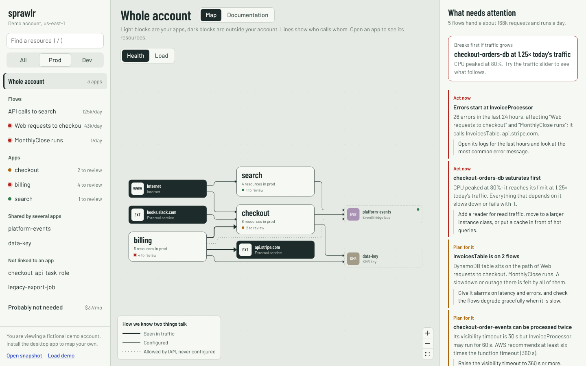
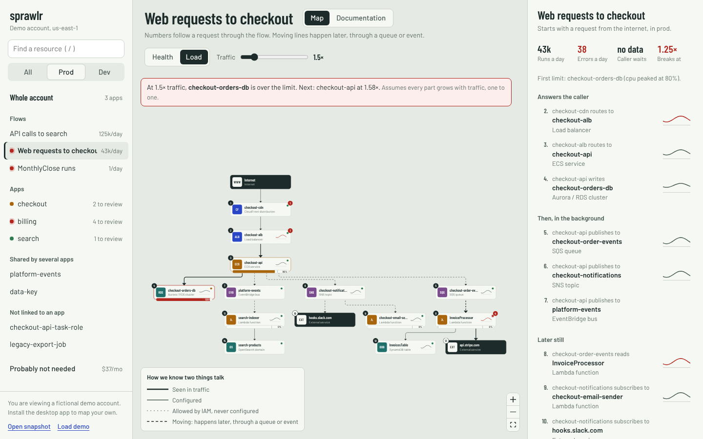

# sprawlr

A local desktop map of your AWS account. It reads your infrastructure (read-only), works out which resources belong to which app and environment, and draws how they talk to each other.





## What it shows

- **What needs attention**, first thing on screen: where errors start, what saturates first if traffic grows, queues that can lose or duplicate messages, dependencies many flows share. Each item says why and what to do.
- **Flows**: the paths requests and events take, found from entry points (public endpoints, schedules) and told step by step: what answers the caller, then what happens later through queues and events. Each flow shows its runs, errors, wait time and where it breaks first.
- **Bottlenecks and what-if**: every resource's busiest hour against its limit (database CPU, service CPU and memory, Lambda concurrency, API throttles). Drag the traffic slider to see what saturates at 1.5× or 3× and in which order.
- **Probably not needed**: idle, orphaned and forgotten resources (NAT gateways with no traffic, unattached Elastic IPs, unused security groups, functions nobody calls) with the evidence and what they cost a month.

- **Apps**, grouped from tags, CloudFormation stacks, naming and connections. Every assignment says how it was inferred.
- **How components communicate**, with the evidence behind each line: seen in traffic (X-Ray), configured, or only allowed by IAM. Third parties your code calls (payment APIs, webhooks, custom origins) appear as dark blocks.
- **Health**: CloudWatch alarms on every node and 24 hours of the metrics that matter per service (requests, errors, latency, backlog, throttles), as sparklines on the map and in the details.
- **Where things run**: VPCs drawn as territories, environments (prod, dev…) as a filter.
- **What to review**: plain-text secrets, alarms and error spikes, public databases and buckets, unencrypted storage, internet exposure, unused or cross-environment permissions, secrets never rotated or unused.
- **Differences between environments**: what exists in prod but not in dev, and settings that drift (Multi-AZ, task counts, container image versions).
- **Blast radius**: select a resource to see everything that breaks if it fails.
- **Documentation**: one Markdown page per app (diagrams per environment, components, data flows, network, secrets, differences between environments, findings) plus an account index. Mermaid diagrams render on GitHub, GitLab and most wikis. See [examples/demo-architecture](examples/demo-architecture/README.md).

Secret values and data are never read. `iam-policy.json` grants only discovery calls and explicitly denies reading secrets, objects, items and messages. Telemetry uses `GetMetricData`, which CloudWatch bills (a few cents per scan); turn it off with `--no-telemetry` or the checkbox in the app.

## What it reads

| Source | Gives |
|---|---|
| EC2 | VPCs, subnets, security groups and who can reach whom |
| Lambda | functions, triggers, roles, references in environment variables |
| Cloud Control | ECS services and task definitions, load balancers and target groups, RDS/Aurora, API Gateway (HTTP), SQS (with dead-letter queues), SNS, DynamoDB, S3, KMS, Step Functions (definitions are walked), EventBridge rules, CloudFront origins |
| Native APIs | REST API integrations, SNS subscriptions, secret rotation and last use, tags |
| Telemetry | CloudWatch alarms and metrics, X-Ray service graph |

Each Cloud Control type is interpreted by a small pure function in `crates/sprawlr-scan/src/extract.rs`. Supporting a new service is one function and a JSON fixture test.

## Run it

```bash
# desktop app (needs Rust, Node 20+ and the Tauri prerequisites for your OS)
cd app && npm install && npx tauri dev

# no AWS account? the app opens on a fictional demo account,
# and the CLI can write the same demo or scan a real account:
cargo run -p sprawlr-cli -- demo
cargo run -p sprawlr-cli -- scan --profile my-profile --region us-east-1 --region eu-west-1

# documentation from any snapshot (handy in CI, commit the folder to track changes)
cargo run -p sprawlr-cli -- docs --snapshot snapshot.json --out architecture
```

`aws-sdk-ec2` needs about 10 GB of RAM to compile. On smaller machines build with `--no-default-features` (VPC and security group scanning is skipped).

## Layout

| Path | What |
|---|---|
| `crates/sprawlr-core` | Architecture graph, app/environment inference, findings, docs generator, blast radius, demo account |
| `crates/sprawlr-scan` | Read-only AWS discovery, relationship extractors, telemetry |
| `crates/sprawlr-cli` | `sprawlr scan` / `sprawlr docs` / `sprawlr demo` |
| `app/` | Tauri 2 + React + React Flow + ELK desktop app (also runs as a web demo) |

## License

Apache-2.0
