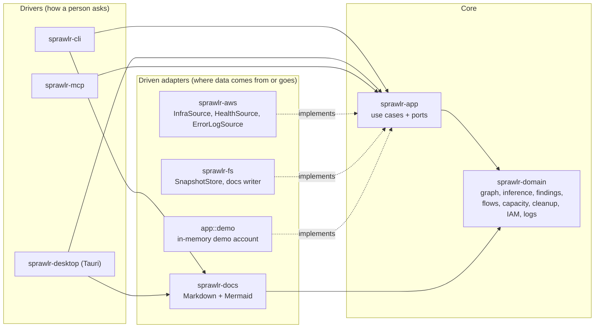
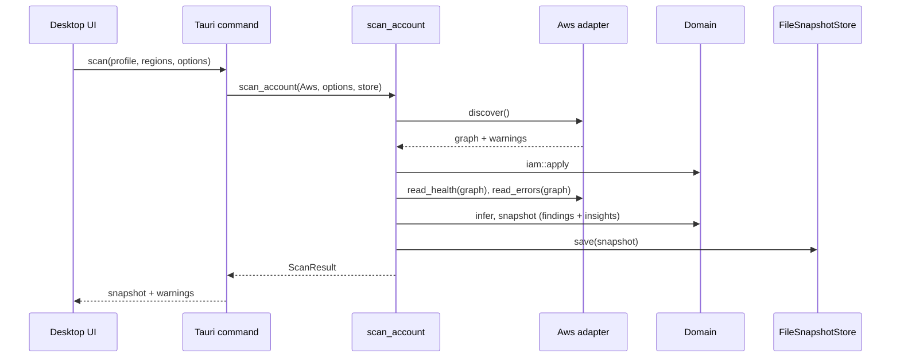

# Architecture

sprawlr is built as a hexagon: a pure domain in the middle, use cases around it, and adapters at the edges. AWS is one adapter among several; the demo account and the test doubles are others.



## Dependency rule

Arrows point inwards. Each crate may depend only on what is listed:

| Crate | Layer | May depend on | Never |
|---|---|---|---|
| `sprawlr-domain` | domain | `serde`, `petgraph`, `chrono`, `regex` | I/O, async, AWS SDKs, any other sprawlr crate |
| `sprawlr-app` | application | `sprawlr-domain`, `anyhow`, `serde`, `serde_json`, `chrono` | AWS SDKs, file system, Tauri, reading the clock (callers pass `now`) |
| `sprawlr-docs` | adapter (presentation) | `sprawlr-domain` | I/O |
| `sprawlr-aws` | adapter (driven) | `sprawlr-app`, `sprawlr-domain`, AWS SDKs | `sprawlr-fs`, drivers |
| `sprawlr-fs` | adapter (driven) | `sprawlr-app`, `sprawlr-docs`, `sprawlr-domain` | AWS SDKs |
| `sprawlr-cli`, `sprawlr-mcp`, `app/src-tauri` | drivers | everything above | business rules (they wire, parse and print) |

Cargo enforces most of this: a crate cannot use what it does not list. Reviews enforce the rest (no rules in drivers, no I/O in the domain).

## Ports

Defined in `crates/sprawlr-app/src/ports.rs`.

| Port | Meaning | Adapters |
|---|---|---|
| `InfraSource` | The structure of an account: resources, containment, declared connections | `sprawlr_aws::Aws`, `sprawlr_app::demo::Demo` |
| `HealthSource` | Alarms, metrics, traces for resources already in the graph | `Aws`, `Demo` (no-op) |
| `ErrorLogSource` | Error lines from logs, kept as masked patterns | `Aws`, `Demo` (no-op) |
| `SnapshotStore` | The latest snapshot between runs, and optionally the last full scans (to say what changed) | `sprawlr_fs::FileSnapshotStore` (keeps 30 scans in `history/`), in-memory store in tests |
| `SettingsStore` | The desktop app's choices (background refresh, notifications, last profile) | `sprawlr_fs::FileSettingsStore`, in-memory store in tests |
| `Notifier` | Tells a person something got worse while they were not looking | `TauriNotifier` (desktop driver, since it needs Tauri), inbox double in tests |

## Use cases

`crates/sprawlr-app/src/usecases.rs`:

- `scan_account`: discover, then add IAM reach (`domain::iam`). Read health and error logs if asked. Infer apps and environments, analyse, and save.
- `refresh_health`: same, from a snapshot, without rediscovering the structure. `RefreshOptions` says whether error logs are read again.
- Both tell what changed against the previous full scan in the store (for a refresh, the scan before the one it refreshes) and keep full scans in the history.
- `refresh_in_background`: health only (never discovery or logs) for the stored scan, then at most one notification for what got worse, once a day per item.

`queries` answers questions about a snapshot as plain data (status, apps, flows, a resource with its connections and evidence, blast radius, failures, recommendations, cleanup, search). The MCP server is a thin driver over it, and other drivers can reuse it.

Documentation is rendered by `sprawlr_docs::render(&Snapshot)` and written by `sprawlr_fs::write_docs`.

## Inside the domain

| Module | Does |
|---|---|
| `model`, `graph` | Nodes, typed edges with evidence (`Permitted < Declared < Observed`), containment, the `Snapshot` |
| `infer` | Apps and environments from tags, stacks, naming, containment and connections; each answer says how it was found |
| `analysis` | Findings (security, reliability, drift between environments) |
| `insights::{flows, capacity, rules, lifecycle, signals}` | Flows from entry points, headroom and what-if, recommendations, cleanup |
| `iam` | Policy evaluation: what a role allows, as `Permitted` edges; broad grants as findings |
| `logs` | Error lines reduced to masked templates |
| `status` | The account in one line for the tray: level, headline, items, flows with errors, cleanup; what got worse between two reads |
| `changes` | What changed between two scans of the same account, stored with the snapshot |
| `fixtures` (feature) | The fictional demo account used by tests and the demo adapter |

## The snapshot contract

`Snapshot` (Rust, `sprawlr-domain/src/graph.rs`) is the only thing the UI receives. Its TypeScript mirror is `app/src/domain/types.ts`. A field added in Rust must be added there in the same change, with `#[serde(default)]` on the Rust side so older snapshots still load.

## Frontend

```
app/src/
  domain/      pure view logic over a snapshot (no React, no I/O), unit tested with vitest
  platform/    the Backend port and its adapters: tauri.ts (desktop), web.ts (browser demo)
  features/    one folder per feature: map, flows, details, briefing, cleanup, docs, navigation, scan, tray, changes
  ui/          small shared components (Spark, Dot)
  demo/        the bundled fictional account and freshen(), which keeps its read looking recent
  app/         the shell that composes features
```

Features read data through `domain` and reach the outside only through `useBackend()`. Nothing outside `platform/` imports `@tauri-apps/*`.

## Data flow of a scan


