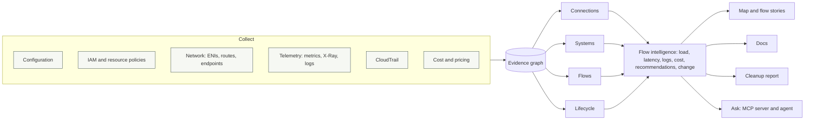
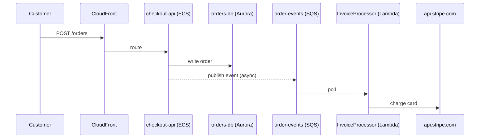

# sprawlr: from resources to understanding

**Status:** draft for discussion · **Scope:** inference engine, flow intelligence, lifecycle detection

> Turn 3,000 resources into 12 systems, 30 flows and a list of what is no longer needed, with the evidence behind every claim.

---

## 1. The problem

AWS accounts grow faster than anyone's understanding of them. A mature account has thousands of resources created by different teams, pipelines and people over years. The knowledge of *what is this for* and *what talks to what* lives in a few heads, in diagrams that stopped being true months ago, and in tags that were never applied consistently.

The questions people actually ask are not about resources:

- What systems run in this account, and what does each one do?
- When a customer places an order, what happens, step by step?
- This bucket / queue / function: who uses it? Can I delete it?
- Why is this flow slow today? What changed?
- What are we paying for that nobody uses?
- If traffic doubles, what breaks first?

Today answering any of them means opening a dozen consoles, reading IAM policies by hand, grepping environment variables and asking around.

## 2. What sprawlr becomes

A local, read-only tool that **infers** how an account works instead of drawing what it contains:

1. **Systems**, found from how resources relate, even with no tags.
2. **Flows**: the paths requests and events take, from entry point to final store, told as stories.
3. **Lifecycle** of every resource: active, idle, orphaned, dangling, zombie, unowned.
4. **Flow intelligence**: load, latency, logs, cost and concrete recommendations per flow.
5. **Explanations**: every connection, grouping and recommendation shows the evidence it rests on.

## 3. Landscape: what exists and what is missing

| Tool | What it does well | Where it stops |
|---|---|---|
| CloudWatch Application Map | Groups services by relationships, shows SLOs and recent deployments; since Nov 2025 also discovers un-instrumented services | Centred on services emitting Application Signals telemetry; it does not explain IAM reachability, idle resources or flows as stories |
| AWS DevOps Agent | Builds a topology of resources and relationships and investigates incidents by correlating telemetry, code and deployments | A managed agent focused on incident response; discovery of tagged resources relies on Resource Explorer; not local or open source |
| IAM Access Analyzer (unused access) | Unused roles, keys and permissions over a tracking window | Identity only; does not connect findings to the architecture |
| Waste scanners (awsspectre, aws-zombie-hunter) | Idle and orphaned resources with cost estimates | Per-resource checks; no graph, no idea which system or flow a resource serves |
| Diagram tools (Cloudcraft; Workload Discovery, archived Aug 2026) | Pictures of resources | Draw inventory, do not infer behaviour |

**The gap sprawlr fills:** one explainable graph that combines configuration, IAM, traffic and change history to answer *why a resource exists, which flows it serves and whether it is still alive*, locally, without instrumenting anything, open source.

## 4. Principles

1. **Evidence over guesses.** Every edge, group and recommendation carries the facts it came from. No evidence, no claim.
2. **Useful with zero setup, better with telemetry.** Configuration and IAM alone must give a good map. Metrics, X-Ray and logs make it sharper.
3. **Deterministic first, AI to narrate.** Rules and graph algorithms decide; language models name, summarise and answer questions, always citing evidence ids. The product works with AI turned off.
4. **Local and read-only.** Runs on the user's machine with their credentials. Never reads secret values or data, never changes anything. AI runs on Bedrock in the user's account or a local model.
5. **Humans decide.** sprawlr proposes deletions and fixes; it never performs them.

## 5. Architecture

Crates: `sprawlr-collect` (today `sprawlr-scan`), `sprawlr-graph` (today `sprawlr-core`), new `sprawlr-infer` (connections, systems, flows, lifecycle), new `sprawlr-intel` (flow intelligence, recommendations), `sprawlr-mcp`.

## 6. The evidence graph

Every edge is a claim with typed evidence. The kinds extend what exists today:

| Evidence | Example | Weight |
|---|---|---|
| Observed | X-Ray edge, VPC Flow Log between two ENIs, CloudTrail `sqs:ReceiveMessage` by a role | 1.0 |
| Declared | Lambda trigger, S3 notification, env var holding a queue URL, task definition secret | 0.9 |
| Permitted, specific | Role policy allows `s3:GetObject` on `arn:aws:s3:::reports/*` | 0.6 |
| Permitted, broad | `s3:*` on `*`: recorded as a finding, not as edges to every bucket | 0 (finding only) |
| Inferred | Same deployment, change together, naming | 0.2 to 0.4 |

Confidence of an edge combines independent evidence with noisy-OR: `1 − Π(1 − wᵢ)`. The UI shows the strongest evidence; details list all of it.

Contradictions are findings in themselves:

- **Permitted, never observed or declared**: unused permission (least privilege).
- **Observed, not declared anywhere**: hidden dependency (undocumented, often a hard-coded endpoint).
- **Declared, target missing**: dangling reference (broken or leftover configuration).

## 7. Inference

### 7.1 Connections

Three families of extractors, each a pure function tested with fixtures.

**Configuration** (extends what exists): S3 event notifications (Lambda, SQS, SNS, EventBridge); EC2 instances and Auto Scaling groups (instance profile, target groups, user-data references); EventBridge Pipes (source → enrichment → target); CloudWatch Logs subscription filters; Route 53 records aliased to ALB, CloudFront, API Gateway; RDS Proxy; ElastiCache; Kinesis consumers; AppSync data sources; VPC endpoints and NAT gateways.

**IAM analyzer.** For each compute principal (Lambda role, ECS task role, EC2 instance profile, Step Functions role, CodeBuild role) resolve attached, inline and group policies, then map statements to edges:

| Action pattern | Edge |
|---|---|
| `s3:GetObject`, `dynamodb:GetItem`/`Query`, `sqs:ReceiveMessage`, `kinesis:GetRecords` | reads |
| `s3:PutObject`, `dynamodb:PutItem`, `sqs:SendMessage`, `sns:Publish`, `events:PutEvents` | writes / publishes |
| `lambda:InvokeFunction`, `states:StartExecution` | invokes |
| `secretsmanager:GetSecretValue`, `ssm:GetParameter` | uses secret |
| `kms:Decrypt`, `kms:GenerateDataKey` | uses key |

Resource ARNs with wildcards are matched against the inventory. Explicit `Deny`, `NotAction` and `NotResource` are honoured. Conditions are recorded but not evaluated in v1. Resource policies (bucket, queue, topic, key, function) add the reverse direction: who is allowed in. SCPs and permission boundaries are out of scope for v1.

**Network reachability.** ENI inventory maps private IPs to resources (Lambda, ECS task, RDS, ELB, VPC endpoint). Security groups and route tables say what *can* talk; VPC Flow Logs, when present, say what *did*.

### 7.2 Systems without tags

A system is a set of resources that are built, changed and run together. Signals that two resources belong together, combined into an edge weight:

| Signal | Source |
|---|---|
| They communicate (weighted by evidence) | evidence graph |
| Same CloudFormation/CDK stack, Terraform workspace tag, `aws:cdk:path` | config, tags |
| Created in the same deployment (same principal and session, minutes apart) | CloudTrail |
| **Change together over time** (co-change, like co-change analysis on git history) | CloudTrail write events |
| Share an IAM role, a VPC subnet set, a naming root | config |

Algorithm: Leiden community detection on the weighted graph. Explicit tags and stacks are hard constraints (must-link); shared infrastructure (VPCs, KMS keys used by many, event buses) is detected by betweenness and kept outside systems. Each system gets a name and a two-sentence description from an LLM that sees only the system's facts, plus a "why grouped" panel listing the strongest signals.

Co-change is the novel signal. Resources deployed by the same pipeline change in the same windows even when nothing connects them in configuration (a Lambda and the alarm, dashboard and log group that ship with it).

### 7.3 Flows

1. **Entry points:** public CloudFront, API Gateway, internet-facing load balancers; EventBridge schedules; S3 uploads from outside; queues and topics written by principals outside the account.
2. **Path expansion:** follow runtime edges from each entry point to sinks (data stores, third parties). Edges are typed **sync** (invoke, route, query) or **async** (queue, topic, event, stream); async edges split a flow into stages.
3. **Ranking and merging:** weight paths by observed traffic, merge paths that differ only in a branch, keep the top flows per system.
4. **Naming:** "Customer places order", "Monthly invoice run", "Search query", generated from entry point, sinks and system.

### 7.4 Lifecycle

| State | Meaning | Typical signals |
|---|---|---|
| Active | Used recently | traffic metrics > 0, recent CloudTrail data access |
| Idle | Exists and is wired, but no activity in 30/90 days | Lambda `Invocations`, SQS `NumberOfMessagesReceived`, ALB `RequestCount`, RDS `DatabaseConnections`, IAM `RoleLastUsed`, secret `LastAccessedDate` |
| Orphaned | Nothing uses it and it uses nothing | SG with no ENIs, unattached EBS volume, unassociated EIP, target group with no LB, log group of a deleted function |
| Dangling | Configuration points to something that no longer exists | env var with a deleted queue URL, DNS record to a deleted LB (subdomain takeover risk), alarm on a missing dimension |
| Zombie | Idle or orphaned **and** costs money | NAT gateway with no bytes, ALB with no targets, provisioned DynamoDB with no reads |
| Unowned | Created by hand, outside any stack, by a principal that no longer acts | CloudTrail creator, stack membership |

Every lifecycle claim lists its signals, the last activity date, the creator and an estimated monthly cost. A **deletion candidate** must be idle or orphaned, have an empty blast radius, no recent change and no stack that is itself active. The cleanup report sorts by savings and confidence and can emit the CLI commands or the IaC lines to remove, for a human to run.

## 8. Flow intelligence

The flow is the unit people reason about, so analysis happens per flow.

**Documentation.** A page per flow: purpose, sequence diagram, hops (sync or async, timeouts, retries, DLQs), entry and exit contracts, owning system, alarms, runbook ("if `invoice-processor-errors` fires: check the Stripe error pattern in these logs"), and a suggested SLO from history.

**Load.** Throughput per hop over 24 h and 7 days, peak vs average, and **fan-out ratios** ("each order produces 1.0 invoices and 2.3 emails").

**Cost per business transaction.** Metrics times prices gives the cost of one execution of the flow ("a checkout costs 0.0031 USD; 61% is the NAT gateway"). Few tools can say this, and every engineering manager wants to know it.

**Latency.** A waterfall per hop from X-Ray: where the time goes, and how close the chain is to the caller's timeout.

**Logs.** sprawlr knows every log group of every hop (Lambda, ECS `awslogs` configuration, API Gateway and ALB access logs), so it can run one CloudWatch Logs Insights query **across a flow** and fingerprint errors into templates: "3 error patterns in the last 24 h; 82% are Stripe timeouts in InvoiceProcessor". Queries are time-boxed and opt-in because Logs Insights bills per GB scanned.

**What if.** Utilisation per hop (Lambda concurrency, DynamoDB capacity, RDS CPU and connections, consumer throughput) scaled by a traffic factor: "at 2× traffic, orders-db saturates first; at 3×, Lambda concurrency".

**Change correlation.** CloudTrail write events on the flow's resources overlaid on its metrics: "p95 doubled six minutes after `UpdateFunctionCode` on InvoiceProcessor". Shown as correlation, never as cause.

**Recommendations.** A catalogue of rules that only make sense with flow context. Each one shows evidence, estimated impact, effort and the fix:

| Rule | Why it matters |
|---|---|
| SQS visibility timeout shorter than 6× the consumer Lambda's timeout | AWS's guidance for event source mappings; otherwise messages are processed twice |
| Async hop without a DLQ (SQS, SNS subscription, EventBridge target, async Lambda) | failures are lost silently |
| Lambda in a VPC reaching S3 or DynamoDB through a NAT gateway | a gateway endpoint is free and removes NAT data processing charges |
| Caller timeout shorter than callee timeout in a sync chain | callers give up while work continues; retries amplify load |
| Sync chain longer than N hops behind API Gateway's integration timeout | latency budget risk; candidate for async |
| Single-AZ resource in a prod flow | the flow's availability is that resource's availability |
| Hop with no alarm, no tracing or no structured logs | observability coverage per flow, as a percentage |
| Log groups with no retention on high-volume hops | storage cost grows forever |

## 9. The AI layer

| Role | Input | Output |
|---|---|---|
| Namer | facts of a system or flow | short name and description |
| Narrator | flow facts, metrics, findings | documentation and summaries |
| Investigator | MCP tools over the graph, metrics and logs | answers to questions, incident timelines |

**Grounding contract:** the model only sees graph facts and must cite evidence ids; any sentence without a citation is dropped. Deterministic analysis always runs first.

**Evaluation:** a set of reference architectures (the demo account plus synthetic CDK stacks with known systems and flows) with expected outputs. Inference quality is measured as precision and recall of edges, systems and flows on every change, in CI. This turns "smart" into a number.

## 10. Surfaces

- **Home:** the account on one screen: systems, top flows, health, monthly waste.
- **Flow view:** the story with a sequence diagram, a live path on the map (traffic drawn as motion along the edges, the one animation in the product), load, latency, logs and recommendations.
- **Cleanup:** lifecycle states, savings, deletion candidates with evidence.
- **Time:** a slider over snapshots, showing what changed and who changed it.
- **Ask:** a command bar for natural-language questions, and an MCP server so Claude, Kiro or any agent can query the account's architecture.

## 11. Cost and permissions

| Tier | Adds | AWS cost |
|---|---|---|
| Structure (default) | configuration, IAM, network | none |
| Health | alarms, `GetMetricData`, X-Ray | cents per scan |
| History | CloudTrail `LookupEvents` (90 days of management events, low rate limit) | none |
| Deep | Logs Insights per flow, VPC Flow Logs queries, Cost Explorer | billed per GB scanned / per request; opt-in, shown before running |

Each tier has its own IAM policy in the repo. Reads of secret values, objects, items and messages are always denied.

## 12. Roadmap

| Milestone | Delivers | Demo moment |
|---|---|---|
| M1 Evidence | IAM analyzer, resource policies, S3 notifications, EC2/ASG, ENI map, NAT/VPC endpoints, Route 53 | "This EC2 reads `reports` (allowed by its role) and nothing configures it" |
| M2 Lifecycle | states, last activity, creator, cost, cleanup report | "14 zombie resources, 380 USD/month, here is the evidence" |
| M3 Systems | co-change from CloudTrail, Leiden clustering, AI naming, evaluation harness | an untagged account becomes 12 named systems |
| M4 Flows | entry points, sync/async paths, flow pages, sequence diagrams, load, cost per transaction | "Customer places order", end to end, with its cost |
| M5 Flow intelligence | log fingerprints, latency waterfall, recommendations, what-if, change correlation | "At 2× traffic orders-db saturates; errors are Stripe timeouts since this deploy" |
| M6 Ask | MCP server, agent, time slider | "What breaks if I delete this bucket?" answered with evidence |

## 13. Open questions

1. Multi-account from M1, or single account until M4? (Organizations makes systems span accounts.)
2. CloudTrail history: `LookupEvents` only, or optional CloudTrail Lake / S3 trail for data events and longer windows?
3. Which local model is good enough for naming without sending anything to Bedrock?
4. Store snapshots as JSON (today) or move to an embedded database (SQLite/DuckDB) once time travel and history land?
5. Recommendation fixes: describe them, or generate IaC patches (CDK/Terraform) for a PR?

## Sources

- CloudWatch application map GA: https://aws.amazon.com/about-aws/whats-new/2025/10/application-map-generally-available-amazon-cloudwatch
- Application map un-instrumented discovery: https://aws.amazon.com/about-aws/whats-new/2025/11/amazon-cloudwatch-application-map-un-instrumented-discovery
- AWS DevOps Agent topology: https://docs.aws.amazon.com/devopsagent/latest/userguide/about-aws-devops-agent-what-is-a-devops-agent-topology.html
- AWS DevOps Agent CLI reference: https://docs.aws.amazon.com/cli/latest/reference/devops-agent/index.html
- IAM Access Analyzer findings: https://docs.aws.amazon.com/IAM/latest/UserGuide/access-analyzer-findings.html
- awsspectre: https://pkg.go.dev/github.com/ppiankov/awsspectre
- aws-zombie-hunter: https://dev.to/robertobelotti/how-i-built-a-serverless-scanner-to-find-and-kill-zombie-aws-resources-13in
- Workload Discovery on AWS (archived): https://github.com/aws-solutions/workload-discovery-on-aws
