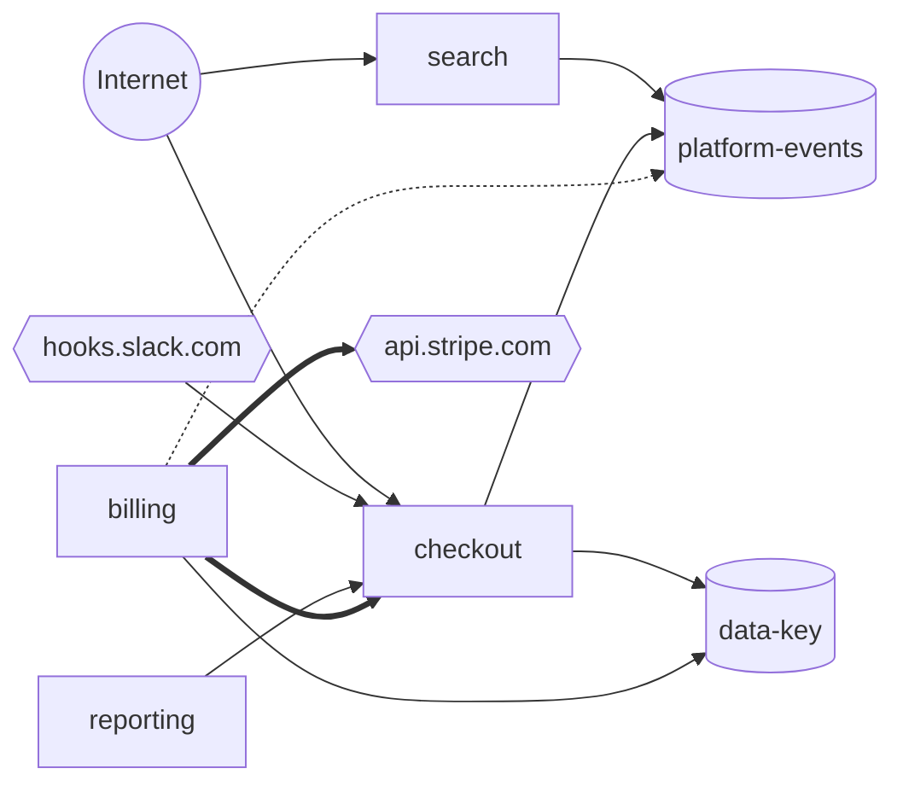
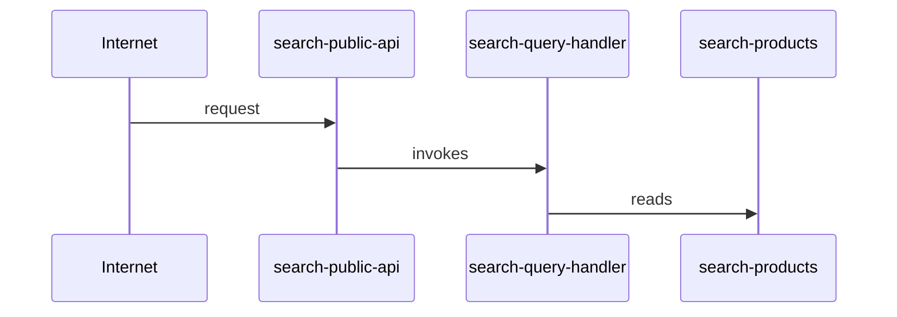
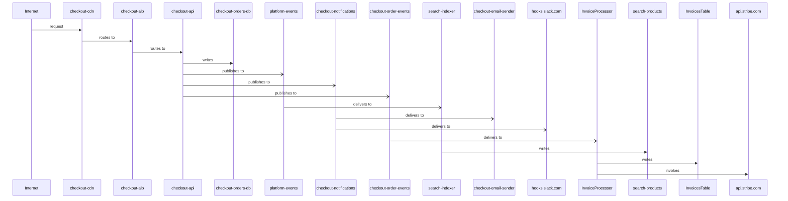
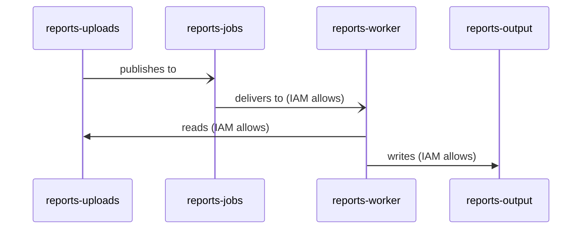
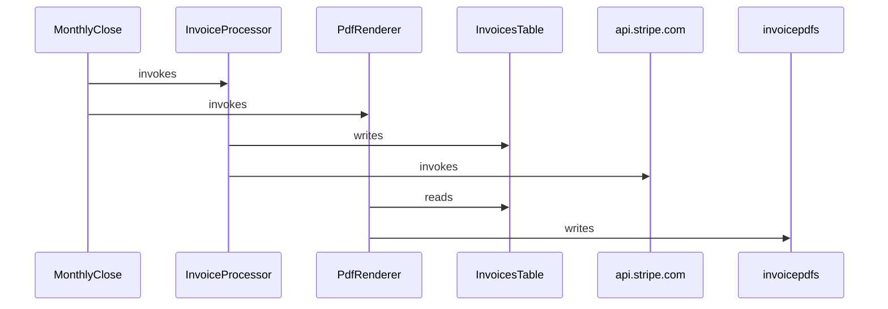
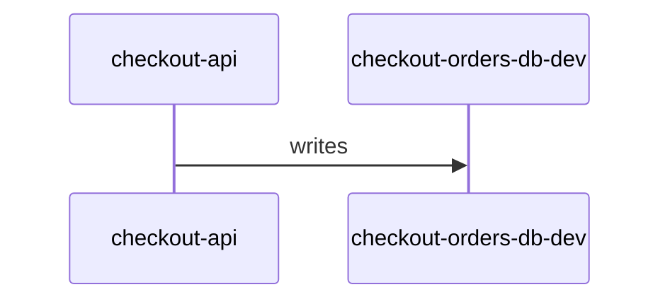
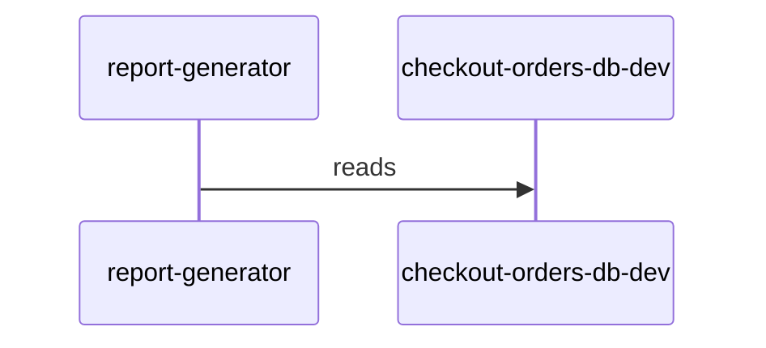

# Architecture of account 111122223333

_Generated by sprawlr from a read-only scan of account 111122223333 on 2026-11-25. Regenerate instead of editing by hand; anything inferred says how it was inferred._

## Changes since 2026-11-23 00:48 UTC

1 new resource, 1 removed, 1 setting changed, 1 new thing to look at, 1 new error message.

- **Needs attention**: checkout-order-events can be processed twice
- **New error**: `checkout-api: pg: connection pool exhausted (max <n> connections), waited <n> ms`
- **New**: reports-output (S3 bucket)
- **Removed**: batch-2023-sg (Security group)
- **Changed**: InvoiceProcessor: Timeout (s) 5 → 60

## What needs attention

- **Act now: Errors start at InvoiceProcessor.** 26 errors in the last 24 hours, affecting “Web requests to checkout” and “MonthlyClose runs”; it calls InvoicesTable, api.stripe.com. Most common in its logs: “Timeout calling https://api.stripe.com/v1/invoices after <n> ms” (19 of 26 error lines). *Start with that message: it is 73% of the error lines.*
- **Act now: checkout-orders-db saturates first.** CPU peaked at 80%; it reaches its limit at 1.25× today's traffic. Everything that depends on it slows down or fails with it. *Add a reader for read traffic, move to a larger instance class, or put a cache in front of hot queries.*
- **Plan for it: InvoicesTable is on 2 flows.** DynamoDB table sits on the path of Web requests to checkout, MonthlyClose runs. A slowdown or outage there is felt by all of them. *Give it alarms on latency and errors, and check the flows degrade gracefully when it is slow.*
- **Plan for it: checkout-order-events can be processed twice.** Its visibility timeout is 30 s but InvoiceProcessor may run for 60 s. AWS recommends at least six times the function timeout (360 s). *Raise the visibility timeout to 360 s or more.*
- **Plan for it: checkout-order-events has no dead-letter queue.** Messages that keep failing are retried until they expire and then disappear without a trace. *Add a redrive policy to a dead-letter queue and alarm on its depth.*
- **Good to know: checkout-orders-db-dev is on 2 flows.** Aurora / RDS cluster sits on the path of Work done by checkout-api (dev), report-generator runs (dev). A slowdown or outage there is felt by all of them, and it runs in a single availability zone. *Give it alarms on latency and errors, and check the flows degrade gracefully when it is slow.*
- **Good to know: search-query-handler is most of the wait in “API calls to search”.** 72% of the 108 ms p95 the caller waits.

## Apps

| App | Resources | Environments | To review |
|---|---|---|---|
| [billing](apps/billing.md) | 5 | prod | 4 (2 high) |
| [checkout](apps/checkout.md) | 10 | dev, prod | 2 |
| [reporting](apps/reporting.md) | 6 | dev, prod | 2 (1 high) |
| [search](apps/search.md) | 4 | prod | 1 |

## How apps connect

## Flows

How requests and events move through the account, found from entry points (public endpoints, schedules). Solid arrows wait for an answer; open arrows happen later, through a queue or event.

### API calls to search

Starts from the internet, 125k runs a day, 0 errors in 24 h.

### Web requests to checkout

Starts from the internet, 43k runs a day, 45 errors in 24 h, breaks first at 1.25× (checkout-orders-db).

Most frequent errors in its logs (24 h):

- 19 × InvoiceProcessor: `Timeout calling https://api.stripe.com/v1/invoices after <n> ms`
- 7 × checkout-api: `pg: connection pool exhausted (max <n> connections), waited <n> ms`
- 5 × InvoiceProcessor: `ConditionalCheckFailedException: invoice <n> already exists`
- 2 × InvoiceProcessor: `KeyError: 'customer_id'`

### Files uploaded to reports-uploads

Starts when data arrives, 1.1k runs a day, 0 errors in 24 h, breaks first at 1.47× (reports-worker).

### MonthlyClose runs

Starts on its own, 1 run a day, 26 errors in 24 h.

Most frequent errors in its logs (24 h):

- 19 × InvoiceProcessor: `Timeout calling https://api.stripe.com/v1/invoices after <n> ms`
- 5 × InvoiceProcessor: `ConditionalCheckFailedException: invoice <n> already exists`
- 2 × InvoiceProcessor: `KeyError: 'customer_id'`

### Work done by checkout-api (dev)

Starts on its own, runs not measured, 0 errors in 24 h.

### report-generator runs (dev)

Starts on its own, runs not measured, 0 errors in 24 h.

## If traffic grows

Each resource's busiest hour against its limit, and the traffic multiplier at which it saturates (assuming everything grows one to one).

| Resource | Busiest hour | Limit | Saturates at |
|---|---|---|---|
| checkout-orders-db | CPU peaked at 80% | 100% | **1.25×** |
| reports-worker | CPU peaked at 68% | 100% | **1.47×** |
| checkout-api | Memory peaked at 63% | 100% | **1.58×** |

## Probably not needed

5 resources look unused, about $36.50 a month at list price. Check the evidence before removing anything.

| Resource | State | Why | Per month |
|---|---|---|---|
| nat-legacy-dev | Costs money, unused | No activity in the last 24 hours. Check a longer window before removing it. | $32.85 |
| 203.0.113.24 | Costs money, unused | This Elastic IP is not attached to anything. | $3.65 |
| migration-2024-sg | Orphaned | No resource uses this security group. | usage-based |
| ci-deploy-2023 | Orphaned | This role has not been used in 410 days. | usage-based |
| legacy-export-job | Idle | No activity in the last 14 days. | usage-based |

## Shared by several apps

- **platform-events** (EventBridge bus), used by billing, checkout, search
- **data-key** (KMS key), used by billing, checkout

## Not linked to an app

Tag these with `app=<name>` to place them.

- 203.0.113.24 (EC2 EIP)
- checkout-api-task-role (IAM role)
- ci-deploy-2023 (IAM role)
- reports-worker-role (IAM role)
- legacy-export-job (Lambda function)

## To review

| Severity | Resource | App | Finding |
|---|---|---|---|
| High | InvoiceProcessor | billing | **Secret stored as plain text**. STRIPE_API_KEY is set directly in environment variables. Move it to Secrets Manager. |
| High | InvoiceProcessor | billing | **Alarm firing**. A CloudWatch alarm on this resource is in ALARM state. |
| High | report-generator | reporting | **Can access another environment**. IAM allows it to read checkout-orders-db (dev → prod), but nothing in its configuration does. |
| Medium | reports-worker | reporting | **Permission covers a whole service**. Its role can read and write every DynamoDB table (policy reports-worker-inline, resource `*`). Limit it to the resources it uses. |
| Medium | checkout-alb | checkout | **5xx from targets in the last 24 hours**. 12 5xx from targets in the last 24 hours. |
| Medium | InvoiceProcessor | billing | **Errors in the last 24 hours**. 26 errors in the last 24 hours. |
| Low | search-public-api | search | **Reachable from the internet**. Public entry point (routes to). |
| Low | checkout-cdn | checkout | **Reachable from the internet**. Public entry point (routes to). |
| Low | InvoiceProcessor | billing | **Permission not seen in use**. IAM allows it to publish to platform-events, but nothing in its configuration or traffic does. Remove what it does not need. |
