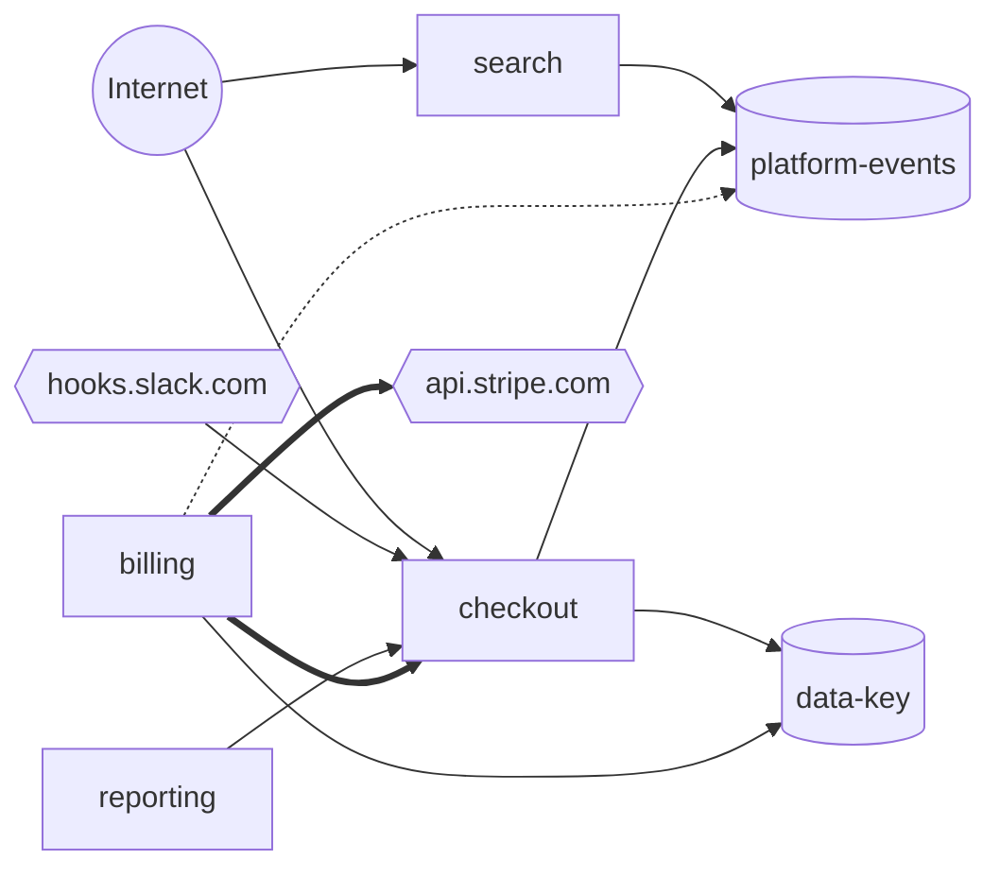

# Architecture of account 111122223333

_Generated by sprawlr from a read-only scan of account 111122223333 on 2026-11-24. Regenerate instead of editing by hand; anything inferred says how it was inferred._

## Apps

| App | Resources | Environments | To review |
|---|---|---|---|
| [billing](apps/billing.md) | 5 | prod | 4 (2 high) |
| [checkout](apps/checkout.md) | 10 | dev, prod | 2 |
| [reporting](apps/reporting.md) | 1 | dev | 1 (1 high) |
| [search](apps/search.md) | 4 | prod | 1 |

## How apps connect

## Shared by several apps

- **platform-events** (EventBridge bus), used by billing, checkout, search
- **data-key** (KMS key), used by billing, checkout

## Not linked to an app

Tag these with `app=<name>` to place them.

- checkout-api-task-role (IAM role)

## To review

| Severity | Resource | App | Finding |
|---|---|---|---|
| High | InvoiceProcessor | billing | **Secret stored as plain text**. STRIPE_API_KEY is set directly in environment variables. Move it to Secrets Manager. |
| High | InvoiceProcessor | billing | **Alarm firing**. A CloudWatch alarm on this resource is in ALARM state. |
| High | report-generator | reporting | **Can access another environment**. IAM allows it to read checkout-orders-db (dev → prod), but nothing in its configuration does. |
| Medium | checkout-alb | checkout | **5xx from targets in the last 24 hours**. 12 5xx from targets in the last 24 hours. |
| Medium | InvoiceProcessor | billing | **Errors in the last 24 hours**. 26 errors in the last 24 hours. |
| Medium | InvoiceProcessor | billing | **Permission never used**. IAM allows it to publish to platform-events, but nothing in its configuration does. |
| Low | search-public-api | search | **Reachable from the internet**. Public entry point (routes to). |
| Low | checkout-cdn | checkout | **Reachable from the internet**. Public entry point (routes to). |
