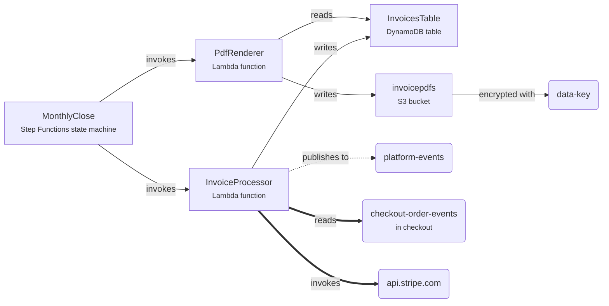

# billing

_Generated by sprawlr from a read-only scan of account 111122223333 on 2026-11-24. Regenerate instead of editing by hand; anything inferred says how it was inferred._

## Summary

- **5 resources**: 5 in prod
- **Entry points from the internet:** none
- **Runs in:** AWS-managed
- **Depends on:** api.stripe.com (third party), checkout, data-key (shared), platform-events (shared)
- **To review:** 4 findings, 2 high

## Architecture in prod

Thick arrows were seen in traffic, plain arrows are configured, dotted arrows are only allowed by IAM. Rounded boxes belong to other apps or are shared.

## Components

| Resource | Type | Environment | Runs in | Health | Placed in this app by |
|---|---|---|---|---|---|
| InvoiceProcessor | Lambda function | prod | AWS-managed | **Alarm** | CloudFormation stack |
| PdfRenderer | Lambda function | prod | AWS-managed | Healthy | CloudFormation stack |
| MonthlyClose | Step Functions state machine | prod | AWS-managed | Healthy | CloudFormation stack |
| InvoicesTable | DynamoDB table | prod | AWS-managed | Healthy | CloudFormation stack |
| invoicepdfs | S3 bucket | prod | AWS-managed | Healthy | CloudFormation stack |

## Health in the last 24 hours

| Resource | Signal | Value | |
|---|---|---|---|
| InvoiceProcessor | Invocations | 9.6k (last 24 h) |  |
| InvoiceProcessor | Errors | 26 (last 24 h) | **26 errors in the last 24 hours** |
| InvoiceProcessor | Throttles | 0 (last 24 h) |  |
| InvoiceProcessor | Duration p95 | 8.8 s (latest) |  |
| InvoiceProcessor | Alarm `invoice-processor-errors` | in ALARM | **firing** |
| PdfRenderer | Invocations | 720 (last 24 h) |  |
| PdfRenderer | Duration p95 | 2.2 s (latest) |  |
| MonthlyClose | Executions | 1 (last 24 h) |  |
| MonthlyClose | Failed executions | 0 (last 24 h) |  |
| InvoicesTable | Write units | 6.0k (last 24 h) |  |
| InvoicesTable | Read units | 14k (last 24 h) |  |
| InvoicesTable | Write throttles | 0 (last 24 h) |  |

## How components communicate

| From | | To | How we know |
|---|---|---|---|
| InvoiceProcessor | writes | InvoicesTable | configured (`env:INVOICES_TABLE`); allowed by IAM (`iam:role/InvoiceProcessorRole`) |
| InvoiceProcessor | invokes | api.stripe.com (third party) | seen in traffic (`xray`) |
| InvoiceProcessor | reads | checkout-order-events (checkout) | seen in traffic (`cloudwatch:NumberOfMessagesReceived`); configured (`lambda:event_source_mapping`) |
| InvoiceProcessor | publishes to | platform-events (shared) | allowed by IAM (`iam:role/InvoiceProcessorRole`) |
| PdfRenderer | reads | InvoicesTable | configured (`env:INVOICES_TABLE`) |
| PdfRenderer | writes | invoicepdfs | configured (`env:OUTPUT_BUCKET`) |
| MonthlyClose | invokes | InvoiceProcessor | configured (`states:definition`) |
| MonthlyClose | invokes | PdfRenderer | configured (`states:definition`) |
| invoicepdfs | encrypted with | data-key (shared) | configured (`s3:bucket_encryption`) |

## Network

- **Outside any VPC** (AWS-managed endpoints): InvoiceProcessor, PdfRenderer, MonthlyClose, InvoicesTable, invoicepdfs

## Secrets, keys and identities

- **data-key**, KMS key (rotation on): used by invoicepdfs
- **InvoiceProcessor** keeps `STRIPE_API_KEY` as plain text in environment variables.

Secret values are never read; only names, usage and rotation settings.

## What breaks if something fails

- **InvoicesTable** (prod): InvoiceProcessor, MonthlyClose, PdfRenderer
- **invoicepdfs** (prod): MonthlyClose, PdfRenderer
- **InvoiceProcessor** (prod): MonthlyClose
- **PdfRenderer** (prod): MonthlyClose

## To review

| Severity | Resource | Finding |
|---|---|---|
| High | InvoiceProcessor | **Secret stored as plain text**. STRIPE_API_KEY is set directly in environment variables. Move it to Secrets Manager. |
| High | InvoiceProcessor | **Alarm firing**. A CloudWatch alarm on this resource is in ALARM state. |
| Medium | InvoiceProcessor | **Errors in the last 24 hours**. 26 errors in the last 24 hours. |
| Low | InvoiceProcessor | **Permission not seen in use**. IAM allows it to publish to platform-events, but nothing in its configuration or traffic does. Remove what it does not need. |
