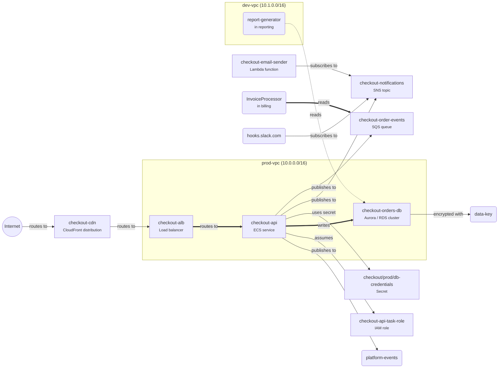
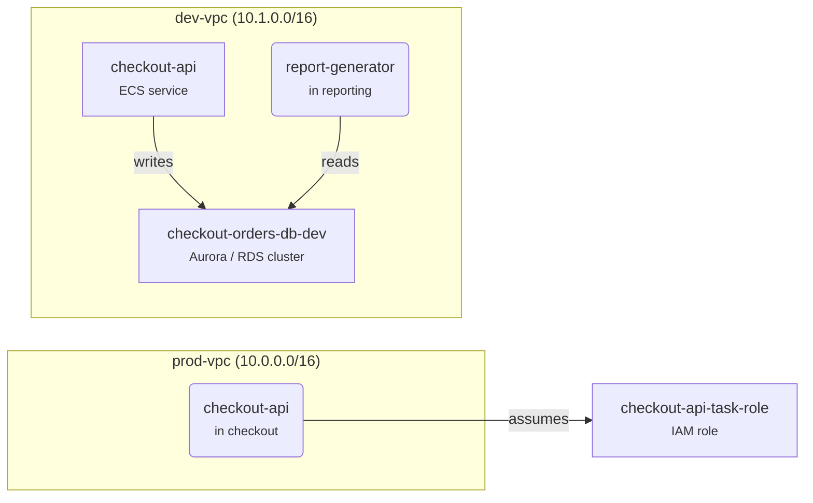

# checkout

_Generated by sprawlr from a read-only scan of account 111122223333 on 2026-11-27. Regenerate instead of editing by hand; anything inferred says how it was inferred._

## Summary

- **11 resources**: 2 in dev, 8 in prod
- **Entry points from the internet:** checkout-cdn (CloudFront distribution)
- **Runs in:** AWS-managed, dev-vpc, prod-vpc
- **Depends on:** data-key (shared), platform-events (shared)
- **Used by:** billing, hooks.slack.com (third party), reporting
- **To review:** 2 findings

## Architecture in prod

## Architecture in dev

Thick arrows were seen in traffic, plain arrows are configured, dotted arrows are only allowed by IAM. Rounded boxes belong to other apps or are shared.

## Components

| Resource | Type | Environment | Runs in | Health | Placed in this app by |
|---|---|---|---|---|---|
| checkout-alb | Load balancer | prod | prod-vpc | Healthy | tag |
| checkout-cdn | CloudFront distribution | prod | AWS-managed | Healthy | tag |
| checkout-api | ECS service | dev | dev-vpc | Healthy | tag |
| checkout-api | ECS service | prod | prod-vpc | Healthy | tag |
| checkout-email-sender | Lambda function | prod | AWS-managed | Healthy | tag |
| checkout-notifications | SNS topic | prod | AWS-managed | Healthy | tag |
| checkout-order-events | SQS queue | prod | AWS-managed | Healthy | tag |
| checkout-orders-db | Aurora / RDS cluster | prod | prod-vpc | Warning | tag |
| checkout-orders-db-dev | Aurora / RDS cluster | dev | dev-vpc | Healthy | tag |
| checkout-api-task-role | IAM role |  | AWS-managed |  | name |
| checkout/prod/db-credentials | Secret | prod | AWS-managed |  | tag |

## Health in the last 24 hours

| Resource | Signal | Value | |
|---|---|---|---|
| checkout-alb | Requests | 43k (last 24 h) |  |
| checkout-alb | 5xx from targets | 12 (last 24 h) | **12 5xx from targets in the last 24 hours** |
| checkout-alb | Response time p95 | 160 ms (latest) |  |
| checkout-api | CPU | 27.5 % (latest) |  |
| checkout-api | Memory | 55.5 % (latest) |  |
| checkout-email-sender | Invocations | 7.2k (last 24 h) |  |
| checkout-email-sender | Errors | 0 (last 24 h) |  |
| checkout-email-sender | Duration p95 | 390 ms (latest) |  |
| checkout-notifications | Messages published | 7.2k (last 24 h) |  |
| checkout-notifications | Failed deliveries | 0 (last 24 h) |  |
| checkout-order-events | Messages sent | 9.6k (last 24 h) |  |
| checkout-order-events | Messages waiting | 3.5 (latest) |  |
| checkout-order-events | Oldest message age | 11 s (latest) |  |
| checkout-orders-db | CPU | 53 % (latest) |  |
| checkout-orders-db | Connections | 120 (latest) |  |

## Errors in logs, last 24 hours

Messages are reduced to patterns: numbers, ids, addresses and values are masked, and the raw lines are never stored.

| Resource | Message | Times | Last seen (UTC) |
|---|---|---|---|
| checkout-api | `pg: connection pool exhausted (max <n> connections), waited <n> ms` | 7 | 2026-11-24 11:58 |

## How components communicate

| From | | To | How we know |
|---|---|---|---|
| Internet | routes to | checkout-cdn | configured (`cloudfront:viewer`) |
| hooks.slack.com (third party) | subscribes to | checkout-notifications | configured (`sns:subscription`) |
| checkout-alb | routes to | checkout-api | seen in traffic (`vpc_flow_logs`); configured (`elb:target_group`) |
| checkout-cdn | routes to | checkout-alb | configured (`cloudfront:origin`) |
| InvoiceProcessor (billing) | reads | checkout-order-events | seen in traffic (`cloudwatch:NumberOfMessagesReceived`); configured (`lambda:event_source_mapping`); allowed by IAM (`iam:role/billing-invoice-role`) |
| checkout-api | assumes | checkout-api-task-role | configured (`ecs:task_role`) |
| checkout-api | publishes to | checkout-notifications | configured (`env:NOTIFICATIONS_TOPIC_ARN`); allowed by IAM (`iam:role/checkout-api-task-role`) |
| checkout-api | publishes to | checkout-order-events | configured (`env:ORDER_EVENTS_QUEUE_URL`); allowed by IAM (`iam:role/checkout-api-task-role`) |
| checkout-api | writes | checkout-orders-db | seen in traffic (`vpc_flow_logs`); configured (`env:DB_HOST`); allowed by IAM (`iam:role/checkout-api-task-role`) |
| checkout-api | writes | checkout-orders-db-dev | configured (`env:DB_HOST`) |
| checkout-api | uses secret | checkout/prod/db-credentials | configured (`ecs:task_definition.secrets`); allowed by IAM (`iam:role/checkout-api-task-role`) |
| checkout-api | publishes to | platform-events (shared) | configured (`env:EVENT_BUS_NAME`); allowed by IAM (`iam:role/checkout-api-task-role`) |
| checkout-email-sender | subscribes to | checkout-notifications | configured (`sns:subscription`) |
| report-generator (reporting) | reads | checkout-orders-db | allowed by IAM (`iam:role/report-generator-role`) |
| report-generator (reporting) | reads | checkout-orders-db-dev | configured (`env:DB_HOST`) |
| checkout-orders-db | encrypted with | data-key (shared) | configured (`rds:kms_key_id`) |

## Network

- **Outside any VPC** (AWS-managed endpoints): checkout-cdn, checkout-email-sender, checkout-notifications, checkout-order-events, checkout-api-task-role, checkout/prod/db-credentials
- **dev-vpc** (10.1.0.0/16): checkout-api, checkout-orders-db-dev
- **prod-vpc** (10.0.0.0/16): checkout-alb, checkout-api, checkout-orders-db
  - checkout-alb: subnets prod-public-a, prod-public-b; security groups checkout-alb-sg
  - checkout-api: subnets prod-private-a, prod-private-b; security groups checkout-api-sg
  - checkout-orders-db: security groups orders-db-sg

**Internet exposure.** Entry points: checkout-cdn (routes to).
Security groups open to 0.0.0.0/0: checkout-alb-sg (tcp 443).

## Secrets, keys and identities

- **checkout-api-task-role**, IAM role: used by checkout-api
- **data-key**, KMS key (rotation on): used by checkout-orders-db
- **checkout/prod/db-credentials**, Secret (rotation on, rotated 12 days ago): used by checkout-api

Secret values are never read; only names, usage and rotation settings.

## Differences between environments

- checkout-cdn (CloudFront distribution) exists in prod but not in dev.
- checkout-api: `desired` is 1 in dev, 4 in prod.
- checkout-api: `images` is checkout-api:2026.11.5 in dev, checkout-api:2026.11.3 in prod.
- checkout-email-sender (Lambda function) exists in prod but not in dev.
- checkout-alb (Load balancer) exists in prod but not in dev.
- checkout-orders-db: `multi_az` is false in dev, true in prod.
- checkout/prod/db-credentials (Secret) exists in prod but not in dev.
- checkout-notifications (SNS topic) exists in prod but not in dev.
- checkout-order-events (SQS queue) exists in prod but not in dev.

## What breaks if something fails

- **checkout-notifications** (prod): checkout-alb, checkout-api, checkout-cdn, checkout-email-sender, hooks.slack.com (third party)
- **checkout-order-events** (prod): InvoiceProcessor (billing), MonthlyClose (billing), checkout-alb, checkout-api, checkout-cdn
- **checkout-orders-db** (prod): checkout-alb, checkout-api, checkout-cdn, report-generator (reporting)
- **checkout/prod/db-credentials** (prod): checkout-alb, checkout-api, checkout-cdn
- **checkout-api** (prod): checkout-alb, checkout-cdn
- **checkout-orders-db-dev** (dev): checkout-api, report-generator (reporting)

## To review

| Severity | Resource | Finding |
|---|---|---|
| Medium | checkout-alb | **5xx from targets in the last 24 hours**. 12 5xx from targets in the last 24 hours. |
| Low | checkout-cdn | **Reachable from the internet**. Public entry point (routes to). |
