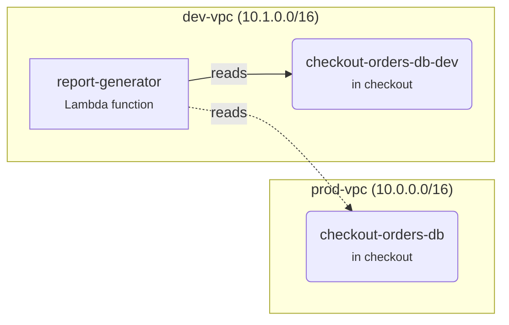

# reporting

_Generated by sprawlr from a read-only scan of account 111122223333 on 2026-11-24. Regenerate instead of editing by hand; anything inferred says how it was inferred._

## Summary

- **1 resources**: 1 in dev
- **Entry points from the internet:** none
- **Runs in:** dev-vpc
- **Depends on:** checkout
- **To review:** 1 findings, 1 high

## Architecture in dev

Thick arrows were seen in traffic, plain arrows are configured, dotted arrows are only allowed by IAM. Rounded boxes belong to other apps or are shared.

## Components

| Resource | Type | Environment | Runs in | Health | Placed in this app by |
|---|---|---|---|---|---|
| report-generator | Lambda function | dev | dev-vpc |  | tag |

## How components communicate

| From | | To | How we know |
|---|---|---|---|
| report-generator | reads | checkout-orders-db (checkout) | allowed by IAM (`iam:role/report-generator-role`) |
| report-generator | reads | checkout-orders-db-dev (checkout) | configured (`env:DB_HOST`) |

## Network

- **dev-vpc** (10.1.0.0/16): report-generator

## Secrets, keys and identities

No secrets, keys or roles detected for this app.

Secret values are never read; only names, usage and rotation settings.

## To review

| Severity | Resource | Finding |
|---|---|---|
| High | report-generator | **Can access another environment**. IAM allows it to read checkout-orders-db (dev → prod), but nothing in its configuration does. |
