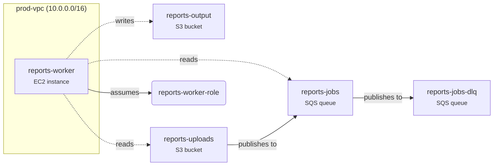
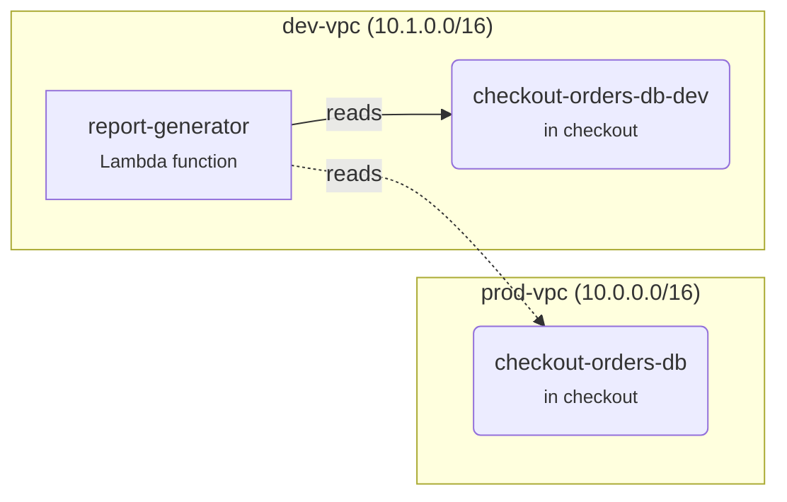

# reporting

_Generated by sprawlr from a read-only scan of account 111122223333 on 2026-11-25. Regenerate instead of editing by hand; anything inferred says how it was inferred._

## Summary

- **6 resources**: 1 in dev, 5 in prod
- **Entry points from the internet:** none
- **Runs in:** AWS-managed, dev-vpc, prod-vpc
- **Depends on:** checkout
- **To review:** 2 findings, 1 high

## Architecture in prod

## Architecture in dev

Thick arrows were seen in traffic, plain arrows are configured, dotted arrows are only allowed by IAM. Rounded boxes belong to other apps or are shared.

## Components

| Resource | Type | Environment | Runs in | Health | Placed in this app by |
|---|---|---|---|---|---|
| report-generator | Lambda function | dev | dev-vpc |  | tag |
| reports-worker | EC2 instance | prod | prod-vpc | Healthy | tag |
| reports-jobs | SQS queue | prod | AWS-managed | Healthy | tag |
| reports-jobs-dlq | SQS queue | prod | AWS-managed | Healthy | tag |
| reports-output | S3 bucket | prod | AWS-managed | Healthy | tag |
| reports-uploads | S3 bucket | prod | AWS-managed | Healthy | tag |

## Health in the last 24 hours

| Resource | Signal | Value | |
|---|---|---|---|
| reports-worker | CPU | 38 % (latest) |  |
| reports-worker | Network in | 5.0 GB (last 24 h) |  |
| reports-jobs | Messages sent | 1.1k (last 24 h) |  |
| reports-jobs | Messages waiting | 1.5 (latest) |  |
| reports-jobs | Oldest message age | 140 s (latest) |  |

## How components communicate

| From | | To | How we know |
|---|---|---|---|
| report-generator | reads | checkout-orders-db (checkout) | allowed by IAM (`iam:role/report-generator-role`) |
| report-generator | reads | checkout-orders-db-dev (checkout) | configured (`env:DB_HOST`) |
| reports-worker | reads | reports-jobs | allowed by IAM (`iam:role/reports-worker-role`) |
| reports-worker | writes | reports-output | allowed by IAM (`iam:role/reports-worker-role`) |
| reports-worker | reads | reports-uploads | allowed by IAM (`iam:role/reports-worker-role`) |
| reports-worker | assumes | reports-worker-role (shared) | configured (`ec2:instance_profile`) |
| reports-jobs | publishes to | reports-jobs-dlq | configured (`sqs:redrive_policy`) |
| reports-uploads | publishes to | reports-jobs | configured (`s3:notification`) |

## Network

- **Outside any VPC** (AWS-managed endpoints): reports-jobs, reports-jobs-dlq, reports-output, reports-uploads
- **dev-vpc** (10.1.0.0/16): report-generator
- **prod-vpc** (10.0.0.0/16): reports-worker
  - reports-worker: subnets prod-private-a; security groups checkout-api-sg

## Secrets, keys and identities

- **reports-worker-role**, IAM role: used by reports-worker

Secret values are never read; only names, usage and rotation settings.

## Differences between environments

- reports-worker (EC2 instance) exists in prod but not in dev.
- report-generator (Lambda function) exists in dev but not in prod.
- reports-output (S3 bucket) exists in prod but not in dev.
- reports-uploads (S3 bucket) exists in prod but not in dev.
- reports-jobs (SQS queue) exists in prod but not in dev.
- reports-jobs-dlq (SQS queue) exists in prod but not in dev.

## What breaks if something fails

- **reports-jobs-dlq** (prod): reports-jobs, reports-uploads, reports-worker
- **reports-jobs** (prod): reports-uploads, reports-worker
- **reports-output** (prod): reports-worker
- **reports-uploads** (prod): reports-worker

## To review

| Severity | Resource | Finding |
|---|---|---|
| High | report-generator | **Can access another environment**. IAM allows it to read checkout-orders-db (dev → prod), but nothing in its configuration does. |
| Medium | reports-worker | **Permission covers a whole service**. Its role can read and write every DynamoDB table (policy reports-worker-inline, resource `*`). Limit it to the resources it uses. |
