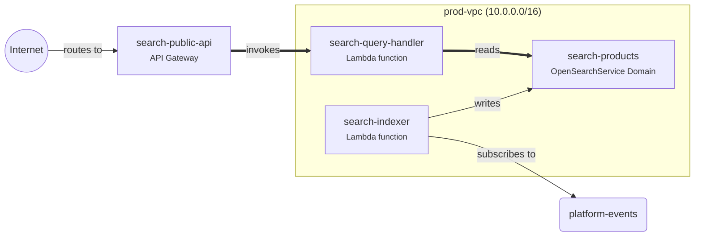

# search

_Generated by sprawlr from a read-only scan of account 111122223333 on 2026-11-27. Regenerate instead of editing by hand; anything inferred says how it was inferred._

## Summary

- **4 resources**: 4 in prod
- **Entry points from the internet:** search-public-api (API Gateway)
- **Runs in:** AWS-managed, prod-vpc
- **Depends on:** platform-events (shared)
- **To review:** 1 finding

## Architecture in prod

Thick arrows were seen in traffic, plain arrows are configured, dotted arrows are only allowed by IAM. Rounded boxes belong to other apps or are shared.

## Components

| Resource | Type | Environment | Runs in | Health | Placed in this app by |
|---|---|---|---|---|---|
| search-public-api | API Gateway | prod | AWS-managed | Healthy | name |
| search-indexer | Lambda function | prod | prod-vpc | Healthy | name |
| search-products | OpenSearchService Domain | prod | prod-vpc | Healthy | name |
| search-query-handler | Lambda function | prod | prod-vpc | Healthy | name |

## Health in the last 24 hours

| Resource | Signal | Value | |
|---|---|---|---|
| search-public-api | Requests | 125k (last 24 h) |  |
| search-public-api | 5xx | 0 (last 24 h) |  |
| search-public-api | Latency p95 | 107.5 ms (latest) |  |
| search-indexer | Invocations | 22k (last 24 h) |  |
| search-indexer | Duration p95 | 595 ms (latest) |  |
| search-query-handler | Invocations | 122k (last 24 h) |  |
| search-query-handler | Errors | 0 (last 24 h) |  |
| search-query-handler | Duration p95 | 77.5 ms (latest) |  |

## How components communicate

| From | | To | How we know |
|---|---|---|---|
| Internet | routes to | search-public-api | configured (`apigateway:public_endpoint`) |
| search-public-api | invokes | search-query-handler | seen in traffic (`xray`); configured (`apigateway:integration`) |
| search-indexer | subscribes to | platform-events (shared) | configured (`events:rule_target`) |
| search-indexer | writes | search-products | configured (`env:OPENSEARCH_ENDPOINT`) |
| search-query-handler | reads | search-products | seen in traffic (`xray`); configured (`env:OPENSEARCH_ENDPOINT`) |

## Network

- **Outside any VPC** (AWS-managed endpoints): search-public-api
- **prod-vpc** (10.0.0.0/16): search-indexer, search-products, search-query-handler

**Internet exposure.** Entry points: search-public-api (routes to).

## Secrets, keys and identities

No secrets, keys or roles detected for this app.

Secret values are never read; only names, usage and rotation settings.

## What breaks if something fails

- **search-products** (prod): search-indexer, search-public-api, search-query-handler
- **search-query-handler** (prod): search-public-api

## To review

| Severity | Resource | Finding |
|---|---|---|
| Low | search-public-api | **Reachable from the internet**. Public entry point (routes to). |
